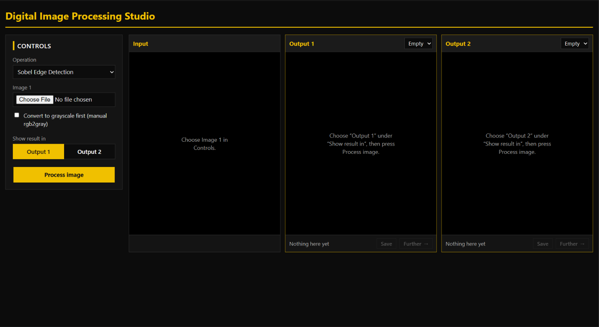
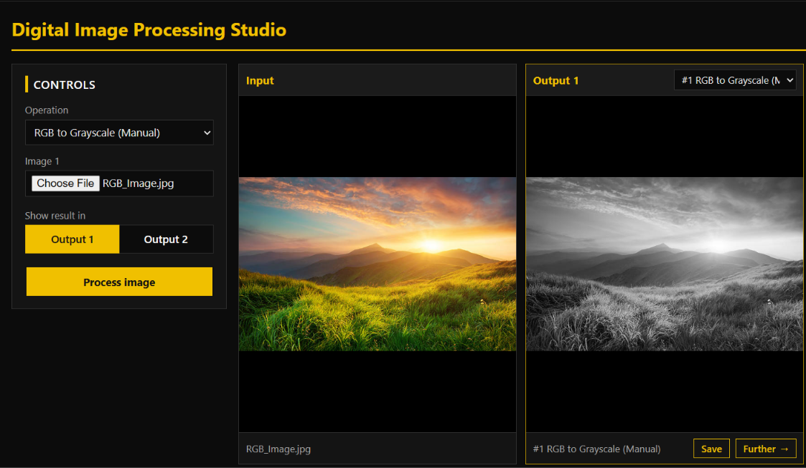
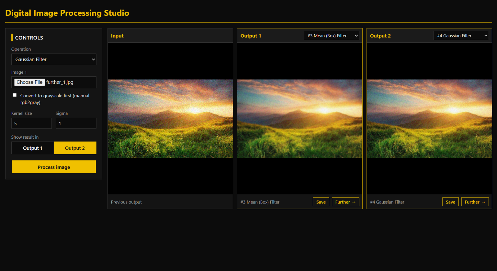
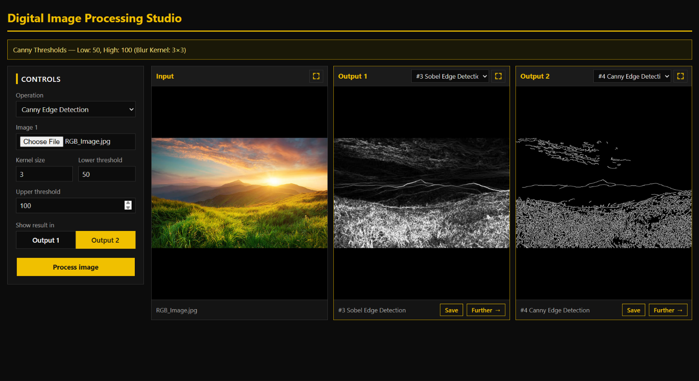
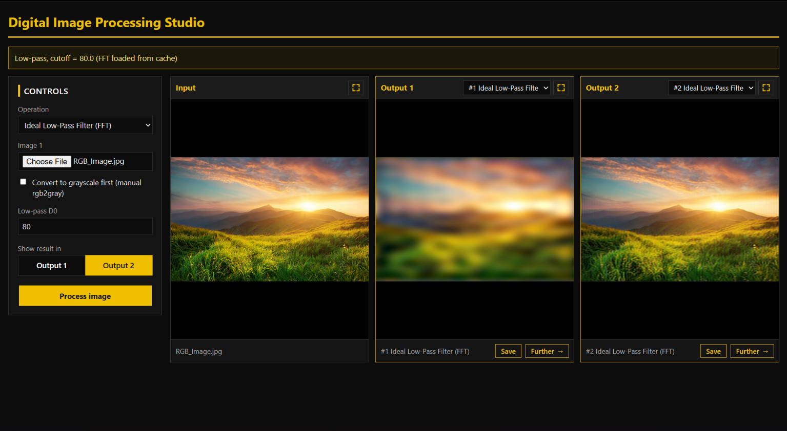
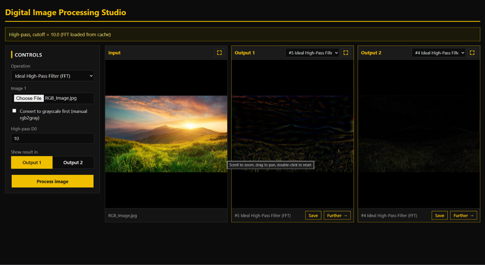
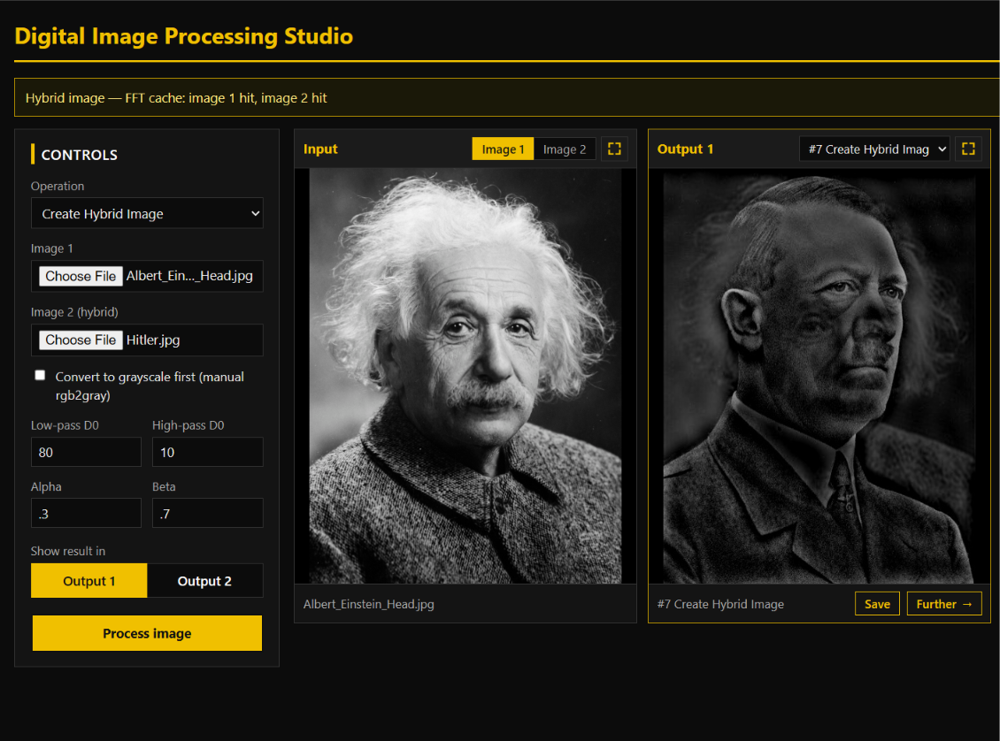
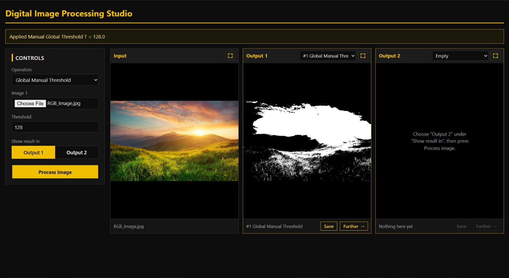
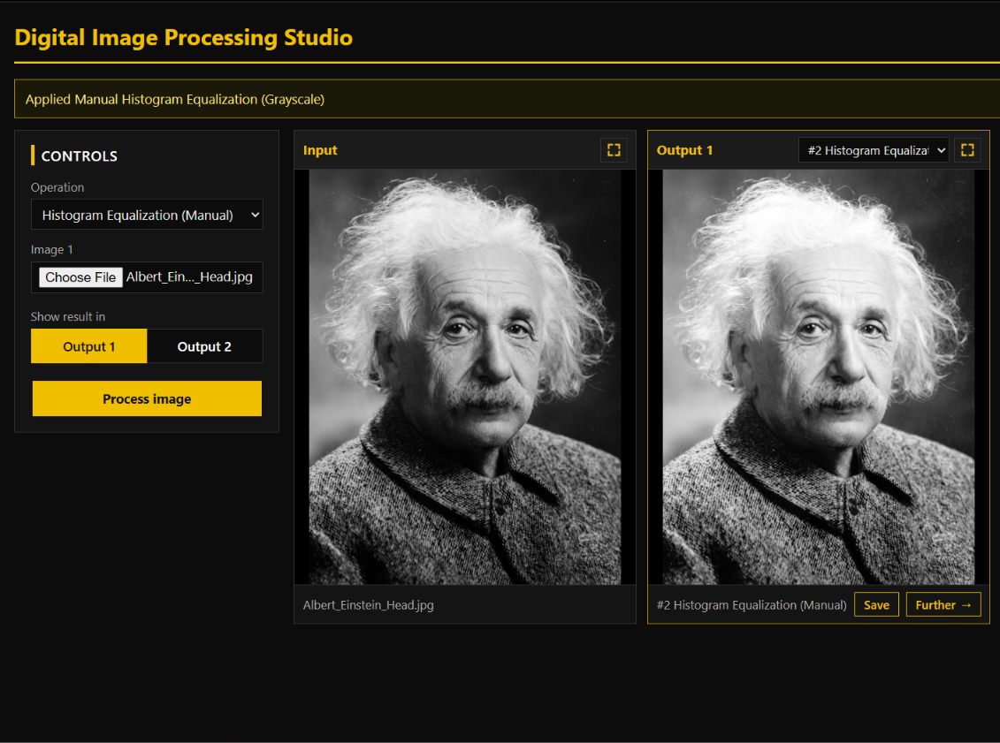

# Vision Tools — Image Processing Playground (Django + NumPy + OpenCV)

An interactive web UI for testing classic image-processing algorithms. Upload an image, choose an operation, tweak its parameters, and compare the result side by side with the original. Most algorithms (convolution, filters, edge operators, FFT filtering, thresholding, histograms, equalization) are **implemented from scratch with NumPy**; OpenCV is used only for image I/O, resizing, and the final Canny stage.

> **About the observations in this document.** The "Observations" sections describe the behavior you should expect from each algorithm *as implemented in this code*. They follow from the math and from reading the source. Each section has an **"Your measurements"** slot and image placeholders so you can replace or confirm them with results from your own test images.
>
> **Image placeholders:** every figure is written as `` followed by an italic caption that says exactly what the image should show. Save your screenshots under `docs/images/` using those file names and they will appear automatically.

---

## Table of Contents

1. [Overview & Feature Map](#1-overview--feature-map)
2. [Architecture & Request Flow](#2-architecture--request-flow)
3. [Installation & Running](#3-installation--running)
4. [Using the UI — Parameter Reference](#4-using-the-ui--parameter-reference)
5. [Algorithms, Experiments & Observations](#6-algorithms-experiments--observations)
   - 6.1 [Grayscale conversion](#61-grayscale-conversion)
   - 6.2 [Noise models](#62-noise-models)
   - 6.3 [Spatial smoothing filters](#63-spatial-smoothing-filters)
   - 6.4 [Edge detection](#64-edge-detection)
   - 6.5 [Frequency-domain filtering](#65-frequency-domain-filtering)
   - 6.6 [Hybrid images](#66-hybrid-images)
   - 6.7 [Thresholding](#67-thresholding)
   - 6.8 [Histograms, equalization & normalization](#68-histograms-equalization--normalization)
6. [Cross-Method Comparison](#7-cross-method-comparison)
7. [Performance & Caching Notes](#8-performance--caching-notes)

---

## 1. Overview & Feature Map

| UI operation (`filter_type`) | Category | Implementation (`utils.py`) | Key parameters |
|---|---|---|---|
| `rgb2gray` | Color | `ensure_gray_from_bgr` | — |
| `awgn` | Noise | `add_awgn` | `noise_mean`, `noise_sigma` |
| `salt_pepper` | Noise | `add_salt_and_pepper_noise` | `sp_amount`, `sp_salt_ratio` |
| `uniform_noise` | Noise | `add_uniform_noise` | `uniform_low`, `uniform_high` |
| `mean` | Smoothing | `mean_filter` (separable box) | `kernel_size` |
| `gaussian` | Smoothing | `gaussian_filter` (separable) | `kernel_size`, `sigma` |
| `median` | Smoothing (non-linear) | `median_filter` (`sliding_window_view`) | `kernel_size` |
| `sobel` | Edges | `sobel_edge_detection` | — |
| `prewitt` | Edges | `prewitt_edge_detection` | — |
| `roberts` | Edges | `roberts_edge_detection` | — |
| `auto_canny` | Edges | `auto_canny` (manual blur + `cv2.Canny`) | `canny_sigma`, `kernel_size` |
| `lowpass` | Frequency | `frequency_filter_pipeline` (ideal LPF) | `cutoff_low` |
| `highpass` | Frequency | `frequency_filter_pipeline` (ideal HPF) | `cutoff_high` |
| `hybrid` | Frequency | `create_hybrid_image` | `cutoff_low`, `cutoff_high`, `alpha`, `beta`, **second image** |
| `threshold` | Segmentation | `threshold_img` | `thresh_val` |
| `iter_threshold` | Segmentation | `iter_threshold` + `threshold_img` | `iter_diff` |
| `local_threshold` | Segmentation | `local_thresholding` (Gaussian adaptive) | `local_win`, `local_c` |
| `equalize` | Histogram | `manual_equalize` | — |
| `normalize` | Histogram | `manual_normalize` | — |
| `plot_histograms` | Histogram | `plot_histograms` (+ `manual_histogram`, `manual_cdf`) | — |

An optional **Convert to grayscale** checkbox (`convert_gray`) applies to every operation.

---

## 2. Architecture & Request Flow

```
Browser form (vision_tools/index.html)
        │  POST: image, [image_2], filter_type, parameters…
        ▼
views.py  ─ image_processor_view()
        │  calls process_image_upload(request.FILES, request.POST)
        ▼
processing.py
   ├─ saves upload(s) to MEDIA_ROOT with a uuid prefix
   ├─ decodes with cv2.imread (BGR)
   ├─ optional grayscale conversion
   ├─ parses + sanitizes parameters (kernel size → odd, ≥ 3; window → odd, ≥ 3)
   ├─ dispatches on `filter_type` → utils.* algorithm
   ├─ (lowpass/highpass/hybrid) FFT disk cache in MEDIA_ROOT/fft_cache/
   └─ writes  processed_<operation>_<file>  → returns context (urls, info, error)
        ▼
Template renders original vs. processed image + info/error message
```

### Files

| File | Responsibility |
|---|---|
| `views.py` | Thin Django view; forwards request data and renders the template. |
| `processing.py` | Upload handling, parameter parsing, operation dispatch, FFT cache, output writing. |
| `utils.py` | All image-processing algorithms (NumPy/OpenCV), no Django dependency. |
| `templates/vision_tools/index.html` | UI form and result display *(not included in the files provided)*. |

---

## 3. Installation & Running

**Requirements:** Python ≥ 3.10 (the code uses `np.ndarray | None` syntax), and:

```bash
pip install django numpy opencv-python matplotlib
```

NumPy ≥ 1.20 is required for `sliding_window_view`.

**Django settings** — uploads and results are stored through `FileSystemStorage`, so media must be configured:

```python
# settings.py
MEDIA_ROOT = BASE_DIR / "media"
MEDIA_URL = "/media/"
```

```python
# project urls.py (development only)
from django.conf import settings
from django.conf.urls.static import static

urlpatterns += static(settings.MEDIA_URL, document_root=settings.MEDIA_ROOT)
```

Add a route to `image_processor_view` in your app's `urls.py`, then:

```bash
python manage.py runserver
```


*Figure 1 — Screenshot of the full UI landing page: file picker(s), operation dropdown, parameter fields, grayscale checkbox, and Submit button.*

---

## 4. Using the UI — Parameter Reference

| Field | Default | Type | Used by | Notes / sanitization |
|---|---|---|---|---|
| `image` | — | file | all | **Required.** Undecodable files return an error message. |
| `image_2` | — | file | `hybrid` | Required only for hybrid; resized to match image 1 (min H, min W). |
| `filter_type` | `sobel` | select | all | Unknown values return "Unknown operation". |
| `convert_gray` | off | checkbox | all | Also forced on for `rgb2gray`. |
| `kernel_size` | 3 | int | mean, gaussian, median, auto_canny (blur) | `< 3` → 3; even → +1 (always odd). |
| `sigma` | 1.0 | float | gaussian | `sigma ≤ 0` switches to automatic sigma `0.3·(r−1)+0.8`. |
| `noise_mean` | 0.0 | float | awgn | Mean of the Gaussian noise. |
| `noise_sigma` | 25.0 | float | awgn | Standard deviation. |
| `sp_amount` | 0.05 | float | salt_pepper | Fraction of pixels corrupted, must be in [0, 1]. |
| `sp_salt_ratio` | 0.5 | float | salt_pepper | Share of corrupted pixels that are white; must be in [0, 1]. |
| `uniform_low` / `uniform_high` | −25 / 25 | float | uniform_noise | `low ≤ high` required. |
| `cutoff_low` | 25.0 | float | lowpass, hybrid (image 1) | Radius in **pixels** of the centered spectrum. |
| `cutoff_high` | 25.0 | float | highpass, hybrid (image 2) | Radius in **pixels** of the centered spectrum. |
| `alpha` / `beta` | 0.5 / 0.5 | float | hybrid | Weights of the low-pass / high-pass parts. |
| `thresh_val` | 128 | float | threshold | Pixels `> T` become 255, others 0. |
| `iter_diff` | 0.001 | float | iter_threshold | Convergence tolerance. |
| `local_win` | 15 | int | local_threshold | `< 3` → 3; even → +1. |
| `local_c` | 5.0 | float | local_threshold | Constant subtracted from the local mean. |
| `canny_sigma` | 0.33 | float | auto_canny | Spread of the median-based thresholds. |

> **Tip — chaining operations.** The UI runs one operation per request. To chain (e.g. *Gaussian noise → Median filter → Sobel*), right-click the processed image, save it, and upload it as the next input.

---

## 5. Algorithms, Experiments & Observations

### 5.1 Grayscale conversion

**Algorithm.** `ensure_gray_from_bgr` computes the luminance weighted sum  
`Gray = 0.2989·R + 0.5870·G + 0.1140·B` (weights applied in BGR order because OpenCV loads BGR), then rounds and clips to `uint8`.

**Observations**

- Green dominates the result, so green foliage looks bright and blue skies/water look dark.
- A plain channel average `(R+G+B)/3` looks flatter; the weighted sum matches how the eye perceives brightness.
- Many other operations (threshold, equalize, auto-Canny, local threshold, iterative threshold) convert to gray internally even if the checkbox is off.


*Figure 2 — Side by side: original color image (left) and its grayscale result (right). Choose an image with strongly colored regions (e.g. red flowers on green leaves).*

---

### 5.2 Noise models

Noise is added so that the filters in 6.3 can be evaluated.

| Model | How it is generated | Visual signature |
|---|---|---|
| **AWGN** | `N(mean, σ)` drawn independently per pixel **and per channel**, added, then clipped | Fine grain over the whole image; colored speckle on color images |
| **Salt & Pepper** | One random draw per pixel *location*; pixels become pure 255 (salt) or 0 (pepper) in **all channels** | Sparse, extreme white/black dots; no color noise |
| **Uniform** | `U(low, high)` per pixel and channel, added, then clipped | Similar to AWGN but with bounded amplitude (no outliers beyond `low`/`high`) |

**Parameter variation observations**

| Parameter | Setting | Expected result |
|---|---|---|
| AWGN `σ` | 10 | Barely visible grain |
| | 25 (default) | Clearly visible grain; details still recognizable |
| | 50+ | Heavy grain; fine detail and edges are hard to see |
| AWGN `mean` | ≠ 0 (e.g. +30) | Overall brightness shift (darker/brighter image), clipping at 0/255 |
| S&P `amount` | 0.01 | Few isolated dots |
| | 0.05 (default) | Obvious but sparse dots |
| | 0.20+ | Image heavily corrupted; median filters start to fail |
| S&P `salt_ratio` | 0.5 | Even mix |
| | 1.0 / 0.0 | Only white or only black dots |
| Uniform `[low, high]` | ±25 | Mild grain |
| | Asymmetric (e.g. 0 to 50) | Brightness shift, like a non-zero AWGN mean |

> Clipping matters: in very dark or very bright regions, negative/positive noise is cut off at 0/255, so noise looks weaker there.


*Figure 4 — A 4-panel strip: original, AWGN, Salt & Pepper from the same source image.*

---

### 5.3 Spatial smoothing filters

**Algorithms**

- **Convolution (from scratch).** `convolve` pads with *reflection*, then accumulates `weight × shifted view` for each kernel tap — `k²` vectorized passes instead of a pixel loop. Works on 2D and 3D arrays.
- **Mean filter.** Box kernel `1/k` applied separably (vertical pass, then horizontal pass).
- **Gaussian filter.** 1D Gaussian `exp(−x²/2σ²)`, normalized, applied separably. If `σ ≤ 0`, sigma is chosen automatically from the kernel radius.
- **Median filter.** Non-linear; the median of each `k×k` neighbourhood via `sliding_window_view`.

**Observations**

| Noise → Filter | Mean | Gaussian | Median |
|---|---|---|---|
| **AWGN / Uniform** | Reduces noise (std drops roughly by the kernel width, since noise is independent per pixel) but blurs edges uniformly | Similar noise reduction, smoother and more natural blur; edges preserved slightly better for the same `k` | Moderate reduction; edges preserved better than mean, but can create a slightly "painted" look at large `k` |
| **Salt & Pepper** | Poor — each impulse is smeared into a gray blob of size `k×k` | Poor — impulses become soft gray spots | **Excellent** — an isolated extreme pixel is never the median, so it disappears with little blur |
| **Edges** | Blurred | Blurred, less blocky than mean | Preserved best |
| **Fine texture** | Lost | Lost gradually | Lost for features smaller than ~`k/2` |

**Parameter variation observations**

| Parameter | Effect |
|---|---|
| `kernel_size` 3 → 7 → 15 | Larger kernels remove more noise **but** blur more detail. Mean at 15×15 produces a very soft image with visible blockiness; Gaussian degrades more gracefully. |
| Gaussian `sigma` small (0.5) with large kernel | Kernel is effectively just its center taps → almost no blur. Large kernels only matter when `σ` is large enough to use them. |
| Gaussian `sigma` large (5+) with small kernel (3) | Kernel approaches a box filter (the kernel truncates the bell curve). |
| Gaussian `sigma = 0` (or negative) | Automatic sigma `0.3·(r−1)+0.8` (r = kernel radius), i.e. a sensible blur for the chosen size. |
| Even `kernel_size` input | Silently bumped to the next odd number (e.g. 4 → 5). |
| Median with large `kernel_size` | Corners round off, thin lines vanish, areas flatten. Also uses much more memory/time (see §8). |
| Color images | All three filters act **per channel**; median filtering a color image per channel can produce slight color fringes because channels are medianed independently. |


*Figure 4 — A 2-panel strip on the same noisy image (AWGN): noisy input, Mean 5×5, Gaussian 5×5 (σ=1.0).*

---

### 5.4 Edge detection

**Algorithms** (all computed with the in-house `convolve`, then magnitude `√(Gx² + Gy²)`)

| Operator | Kernel size | Characteristics |
|---|---|---|
| **Sobel** | 3×3 | Center row/column weighted ×2 → built-in light smoothing perpendicular to the gradient |
| **Prewitt** | 3×3 | Uniform weights → less smoothing, slightly more noise-sensitive than Sobel |
| **Roberts** | 2×2 diagonal | Finest localization, thinnest edges, but the most noise-sensitive and weakest response |
| **Auto-Canny** | Gaussian pre-blur + `cv2.Canny` | Binary, thin, connected edges; thresholds auto-derived from the median: `low=(1−σ)·med`, `high=(1+σ)·med` |

**Observations**

- **Sobel vs. Prewitt:** very similar on clean images; Sobel is a bit smoother and gives slightly stronger edges. The difference becomes visible on noisy input, where Prewitt shows more speckle.
- **Roberts:** produces thinner, sharper edges but looks darker/fainter overall and breaks on noisy images because it has no smoothing.
- **Gradient operators amplify noise.** A derivative acts as a high-pass filter; on a noisy image Sobel/Prewitt/Roberts output is dominated by grain. Smooth first (Gaussian or median), then detect edges.
- **Color input:** edge magnitude is computed per channel, so the output is a color edge map (colors indicate which channel carries the edge). Enable **Convert to grayscale** for the conventional single-channel map.
- **Output range:** magnitude is clipped to 255, so strong edges saturate while weak ones remain dark. The result is a soft gradient map, not a binary edge mask.
- **Auto-Canny:** returns a clean binary edge map. `canny_sigma` smaller → narrower threshold band → fewer edges; larger → more edges. The blur `kernel_size` suppresses texture edges (larger = fewer, cleaner edges). The Gaussian pre-blur here uses its *automatic* sigma, so the `sigma` field of the UI is **not** used by auto-Canny.
- The info box displays the computed low/high thresholds, which depend on the image median — dark images get low thresholds, bright images high ones.

**Parameter variation observations (Auto-Canny)**

| `canny_sigma` | `kernel_size` | Expected result |
|---|---|---|
| 0.15 | 3 | Few edges, only strong contours |
| 0.33 | 3 | Balanced edges (default), some texture edges |
| 0.60 | 3 | Many edges incl. texture and noise |
| 0.33 | 9 | Texture suppressed, only major structure remains |


*Figure 5 — A 2-panel strip on the same clean image: Sobel, Auto-Canny.*

---

### 5.5 Frequency-domain filtering

**Algorithm.** `shifted_fft` computes the 2D FFT and shifts DC to the center. An **ideal circular mask** of radius `cutoff` (in pixels from the center) is multiplied with the spectrum:

- **Low-pass:** keep frequencies inside the circle (blur).
- **High-pass:** `1 − low-pass` (edges / fine detail).

The inverse FFT (`ifftshift` → `ifft2` → real part) returns to the spatial domain.

**Observations**

| Cutoff | Low-pass result | High-pass result |
|---|---|---|
| Very small (5–10) | Extremely blurred; only large color/brightness blobs remain | Almost everything remains; looks like the original minus its DC/average (dark, low contrast), with edges visible |
| Medium (25 default) | Heavily smoothed; shapes recognizable | Edges and fine texture on near-black background |
| Large (80–150) | Mild blur, close to original | Only the finest details/noise survive; image mostly black |

- **Ringing (Gibbs phenomenon).** Because the mask is an *ideal* hard circle, its spatial counterpart is a sinc-like function. Low-pass output shows ripples/halos next to sharp edges, especially at small cutoffs. A Gaussian filter (6.3) is ringing-free for comparison.
- **High-pass output is mostly dark.** Removing the low frequencies (including DC) removes the average brightness; the result has values near zero with positive/negative edge responses, and the negative part is clipped by `_process_matrix`, so only part of the edge information is displayed.
- **Cutoff is in pixels, not normalized.** The same cutoff means a different *relative* frequency on a 500 px vs. a 4000 px image. Higher-resolution images need larger cutoffs for the same visual effect.
- **Frequency-domain noise removal.** Low-pass on AWGN-noisy images removes noise since noise is spread across high frequencies, at the cost of blur and ringing.
- **Color:** the FFT is applied per channel (axes 0 and 1), same mask for all channels.
- **Cache note:** the status message reports `FFT loaded from cache` or `computed and cached`. After the first run on an image, changing only the cutoff reuses the stored FFT (see §8).


*Figure 6 — Low-pass results with cutoff = 10, 80 on the same image.*


*Figure 7 — High-pass results with cutoff = 10, 25, 80 on the same image (3 panels, labeled).*

---

### 5.6 Hybrid images

**Algorithm.** `create_hybrid_image`:

1. Resize both images to the minimum height/width of the pair (bilinear).
2. Low-pass image 1 with `cutoff_low`, high-pass image 2 with `cutoff_high`.
3. Combine: `hybrid = alpha · low₁ + beta · high₂`, then round/clip.

Viewed up close, the high-frequency image (image 2) dominates; from a distance (or when the image is shrunk), only the low-frequency image (image 1) is perceived.

**Observations**

- **Best pairs:** images with similar alignment/pose (e.g. two faces, with eyes roughly aligned). Misaligned images produce a confusing mix.
- **`cutoff_low`** controls how much of image 1 survives; smaller values give a blurrier but more distance-dominant "far" image.
- **`cutoff_high`** controls the detail level of image 2: a *smaller* cutoff keeps more of image 2 (thicker detail, more visible up close); a *larger* cutoff keeps only fine edges (subtle, mostly vanishes at a distance).
- **A good starting point:** the cutoffs should be near each other so the frequency bands complement each other without a large gap or overlap. A gap makes the middle frequencies disappear; a large overlap makes both images visible at all distances.
- **`alpha` / `beta`:** they are *not* normalized. Larger `beta` makes the detail image pop; `alpha + beta > 1` can brighten/saturate the output (clipping), and `< 1` darkens it. The high-pass image has a near-zero mean, so most of the brightness comes from `alpha · low₁`; a low `alpha` darkens the result.
- **Color vs. gray:** if the "Convert to grayscale" box is checked, both are converted; otherwise both stay in color. Hybrid images look cleaner in grayscale.
- **Cache note:** each source image's FFT is cached under its own hash, so tweaking cutoffs/weights on the same pair is fast. The info box shows `hit`/`miss` per image.

**Parameter variation observations**

| `cutoff_low` (img 1) | `cutoff_high` (img 2) | `alpha` / `beta` | Expected result |
|---|---|---|---|
| 15 | 15 | 0.5 / 0.5 | Soft far image + clear near image (good start) |
| 15 | 40 | 0.5 / 0.5 | Gap in middle frequencies; near image shows only thin edges |
| 40 | 10 | 0.5 / 0.5 | Overlap; both images visible at all scales |
| 15 | 15 | 1.0 / 1.0 | Brighter, more contrasty, risk of clipping |
| 15 | 15 | 0.3 / 0.7 | Detail image dominates; overall darker |


*Figure 8 — The hybrid result.*

---

### 5.7 Thresholding

**Algorithms**

| Method | How it works |
|---|---|
| **Manual global** | `pixel > T → 255, else 0` |
| **Iterative global** | Start with `T = (min + max)/2`; split pixels into two groups, compute each group's mean, set `T = (mean₁ + mean₂)/2`; repeat until the change is `≤ iter_diff`. Uses the 256-bin histogram for speed. |
| **Local (adaptive)** | Threshold per pixel = Gaussian-weighted local mean (window `local_win`) `− C`; pixel `< threshold → 0, else 255` |

**Observations**

- **Manual global:** `T` is a pure guess; the UI shows the value used. A dark image with `T = 128` gives nearly all black, a bright one nearly all white.
- **Iterative global:** adapts `T` to the image automatically; the info box shows the converged value. It works well for **bimodal** histograms (dark text on a light page, clear object/background separation). For a unimodal or skewed histogram, the result can be misleading.
- **`iter_diff`:** smaller values only add iterations — the algorithm typically converges within a handful of steps, so the result is practically identical for `1` vs. `0.001`.
- **Uneven illumination:** global methods fail (shadowed regions go black entirely). **Local thresholding** handles shadows because each pixel is compared with its neighborhood.
- **`local_win` effect:**
  - Small (3–7): picks out only fine edges/texture; flat regions become noisy white/black speckle.
  - Medium (15–31): good text/object separation.
  - Large (51+): approaches global-like behavior; large uniform objects become hollow or inverted.
- **`local_c` effect:** a larger positive `C` lowers the threshold, so flat regions turn **white** (cleaner background) but thin dark strokes may vanish. `C = 0` makes flat noisy regions flicker between black and white; a negative `C` makes backgrounds noisy/black.
- All threshold operations output a **binary (0/255) single-channel image**, whatever the input.

**Parameter variation observations**

| Setting | Expected result |
|---|---|
| Manual `T` = 64 / 128 / 200 | Progressively fewer white pixels |
| Iterative on a bimodal image | `T` falls between the two histogram peaks |
| Local, window 15, `C` = 0 / 5 / 15 | Increasing background cleanliness, thinner foreground |
| Local, window 5 / 15 / 51 | Texture-only → balanced → global-like |


*Figure 9 — A 3-panel strip: manual threshold T = 128, labeled with the T.*

---

### 5.8 Histograms, equalization & normalization

**Algorithms**

- **Histogram** `h[k]`: count of pixels per intensity (accumulated with `np.add.at`). **CDF**: running sum of `h`.
- **Equalization:** `mapping[k] = round((CDF[k] − CDF_min) / (N − CDF_min) · 255)`; each pixel is replaced via the lookup table. Works on the grayscale version of the image.
- **Min-max normalization:** `(x − min) / (max − min) · 255` — a linear stretch of the used range to the full [0, 255].
- **`plot_histograms`:** a Matplotlib figure with a histogram and a normalized CDF per channel (Blue/Green/Red, +Alpha if present, or a single Grayscale panel).

**Observations**

| | Equalization | Normalization |
|---|---|---|
| Mapping | Non-linear (follows the CDF) | Linear (stretch) |
| Low-contrast image | Strong contrast boost; fills the full range | Boost only if the image doesn't already use [0, 255] |
| Already full-range image | Still changes the image (redistributes) | **No visible change** (min=0, max=255) |
| Noise | Can amplify noise in flat regions | Preserves noise level relatively |
| Side effects | Can look harsh/over-processed; fine in medical/foggy/dark scenes | Subtle; preserves the original look |
| Output | Grayscale | Same channels as input |

- **Equalized histogram** is flatter but not perfectly flat (discrete intensities cannot be split), with gaps (comb-like) when the original range was narrow.
- **Equalized CDF** is approximately a straight diagonal line, a quick visual check that equalization worked.
- **Normalization of an outlier-containing image:** a single very dark or bright pixel pins min/max and prevents a real stretch. Equalization is robust to this.
- **Color normalization:** min and max are computed over **all channels together** (not per channel), so color balance is preserved but individual channels may remain unstretched.
- **Constant image:** `mx == mn` is handled; the input is returned instead of dividing by zero.
- **Histogram plot reading guide:** a histogram bunched on the left → dark image; bunched on the right → overexposed; narrow → low contrast; spikes at 0/255 → clipping (e.g. after heavy noise or normalization).
- **Per-channel histograms** of a color photo show color casts (e.g. the red channel shifted right in warm photos).


*Figure 10 — Low-contrast: original (left) vs. equalized (right).*

---

## 6. Cross-Method Comparison

### 6.1 Which tool for which problem?

| Problem | Best choice here | Why | Avoid |
|---|---|---|---|
| Gaussian-like grain | Gaussian filter (or mean for speed) | Averaging reduces independent noise | Edge operators directly on noisy input |
| Impulse noise (salt & pepper) | **Median** | Outliers never become the median | Mean/Gaussian (they smear impulses) |
| Bounded/uniform noise | Gaussian or median | Both work; median keeps edges | Very large kernels |
| Finding edges in a clean image | Sobel (smooth), Prewitt, Roberts (fine) | Gradient magnitude | — |
| Thin binary contours | Auto-Canny | Non-max suppression + hysteresis | Gradient operators if you need a clean binary mask |
| Edges in a noisy image | Smooth → Sobel, or Auto-Canny with a bigger blur kernel | Limits noise amplification | Roberts |
| Foggy / dark image | Equalization | Non-linear stretch | Normalization if the range is already full |
| Document with uneven light | Local threshold | Per-pixel adaptive threshold | Global threshold |
| Clean bimodal scene | Iterative threshold | Auto-selects T | Manual guess |
| "Blur without halos" | Gaussian | Smooth kernel | Ideal low-pass (ringing) |
| Look-alike of two images | Hybrid | Frequency band blending | Misaligned image pairs |

### 6.2 Noise × filter result matrix (fill with your measurements)

| | None | Mean 5×5 | Gaussian 5×5 | Median 5×5 |
|---|---|---|---|---|
| **AWGN σ=25** | | | | |
| **S&P 5 %** | | | | |
| **Uniform ±25** | | | | |

### 6.3 Spatial vs. frequency-domain smoothing

| | Spatial (Gaussian) | Frequency (ideal low-pass) |
|---|---|---|
| Cost | Cheap (separable, `O(k)` per pixel) | FFT `O(N log N)`; cached after the first run |
| Artifacts | None | Ringing near edges |
| Control | Kernel size + σ | One cutoff radius |
| Best for | Everyday smoothing | Teaching / hybrid images / spectrum-based reasoning |

---

## 7. Performance & Caching Notes

- **Separable convolution:** mean, Gaussian and local thresholding use two 1D passes (`2k` slice additions) instead of `k²`. Visible when pushing `kernel_size` or `local_win` high.
- **Iterative threshold:** iterates over the 256-bin histogram, not over every pixel, so convergence is nearly instant regardless of image size.
- **Median filter:** the most expensive operation. Time and temporary memory scale with `k²` (it materializes a `H × W × k × k` window stack when computing the median), so large kernels or large photos can be slow or run out of memory.
- **FFT cache (`MEDIA_ROOT/fft_cache/`):**
  - Key = SHA-256 of the uploaded file + processed array shape + `gray`/`color` tag.
  - Re-running low-pass/high-pass/hybrid on the same image with different cutoffs skips the forward FFT; the UI reports *"loaded from cache"*.
  - Stored as `complex64` (8 bytes per element), which is ≈ 16.6 MB for a 1920×1080 grayscale image and about three times that for color.
  - Writes are atomic (temp file + `os.replace`), and a corrupted cache file falls back to recomputation.
  - Slight precision loss vs. `complex128` is invisible after rounding to 8 bits.

---